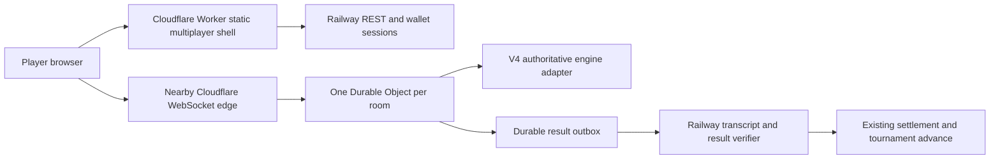

# Orbix multiplayer split: Cloudflare + Railway

Decision date: 2026-10-20. User architecture decision supersedes the earlier skill
recommendation to keep Python as the only runtime.

## Scope and release boundary

Only V4 `token-catch`, `combat-duel`, `boss-raid` are candidates for the Cloudflare
runtime. Number Hunt, RPS, quiz and all other latency-tolerant games remain on
Railway. The game catalog, signed wallet sessions, profiles, room admission,
hold/entry checks, tournament service, wallet accounting, RewardEngine claims and
settlement authority remain Railway services. This is a split, not a bulk migration.

This build delivers the architecture, Worker/DO transport scaffold, signed room
capabilities, room-host metadata and admin host preference. **The TypeScript V4
engine ports and trusted settlement bridge are not complete. No Cloudflare-hosted
game can be published in this scaffold release.** The backend rejects such a
publication before charging or funding, rather than silently falling back to a
second authority. Existing rooms stay on their pinned Railway host. Deployment of
the scaffold alone does not enable games or move rewards.

## Request paths

The Worker serves a build of the existing `/center/rooms/:id` shell and its original
assets through Workers Static Assets. It proxies `/api/center/v1/*` to a fixed
HTTPS Railway origin; browser auth uses the same Bearer-session protocol. Shell
hosting is separate from game authority: opening a Railway room from the CF shell
still routes that room's WebSocket to Railway. Static assets never receive secret
variables. Catalog reads include `hostType` for every room, independent of host.

Cloudflare routes a player's connection through a nearby edge. One room is one
single-location authoritative DO, not a copy of the simulation at every player's
edge. A location hint at first room creation can favor the creator/majority region;
it is a placement hint, not a guarantee. Cross-continent players still incur latency
to that room. Regional measurements, including p50/p95 RTT/jitter and corrections,
are required before claiming an improvement. See [DO data location](https://developers.cloudflare.com/durable-objects/reference/data-location/).

## Host selection and ownership

The existing signed per-game admin customization gains `host: railway|cloudflare`,
default `railway`. Only the three real-time templates may select `cloudflare`.
New publications snapshot the effective host; later toggles never migrate existing
rooms. Legacy rooms without a host record read as Railway. Tournaments schedule
normal match rooms and must use the same host resolver once the ports are enabled;
this release rejects CF tournament creation too.

Future activation is a code-reviewed release after parity gates below; an arbitrary
environment flag must not turn an unfinished engine into a reward authority.
The current API reports the port readiness as false and rejects CF publishing with
`CLOUDFLARE_RUNTIME_NOT_READY`. Changing a preference is still useful for review,
but the admin UI explains that new rooms are blocked until the runtime ships.

## Authentication and provisioning

Railway wallet sign-in stays unchanged. `CENTER_SESSION_SECRET` optionally makes
its HMAC sessions stable across restarts; both the API and the proxied frontend
continue to use them. Do not give Workers an authority signer key or vault key.

For the CF branch, Railway must first enforce visibility, invite, ban/suspension,
capacity, hold gates and confirmed paid entry exactly as it does locally. It then
issues a 120-second signed room capability, with a separate shared
`CENTER_EDGE_TICKET_SECRET` / Worker `EDGE_TICKET_SECRET`. Claims bind version,
issuer, audience, wallet, role, room id, round id and random single-use nonce.
A reconnect requests a fresh admission ticket. Tickets travel in the existing
`session.hello` frame, never in a URL/query string. The DO verifies HMAC/expiry,
checks its frozen roster/round and records nonce consumption durably before
responding `session.ready`. A stolen ticket cannot select another room or round.
Accepted sessions keep their identity in hibernatable socket attachments.

Room creation is an internal signed POST to `/internal/rooms/:id/provision` with
an immutable config hash, round id, server seed, frozen roster, lifecycle revision
and host type. Bootstrap HMAC covers the exact UTF-8 request body, path, timestamp
and nonce, with a distinct provisioning key. The worker checks skew; the DO records
nonce use. Repeated identical bootstraps are idempotent, changed commitments conflict.
Only trusted server code can provision; public clients cannot choose seeds or winners.
This release implements those transport boundaries for local tests, but the API
never provisions an unfinished engine for public gameplay.

## DO engine and protocol compatibility

One `MultiplayerRoom` SQLite-backed DO per catalog room. An engine interface binds
`step(dtMs)`, validated `act(wallet,payload)`, public state, snapshot/restore,
rankings/eligibility and final transcript. The adapter registry has explicit slots
for Catch V4, Combat V4 and Raid V4. Each is unavailable until ported; no alternative
scoring rules or client-supplied positions/results are accepted in its place.

Preserve protocol v1: `session.hello`, `session.ready`, `participant.ready`,
`round.started`, `action`, `action.ack`, `action.rejected`, `game.patch`, `room.sync`,
`room.snapshot`, `connection.ping/pong`, `resync.required`, `settlement.finalized`.
Reuse the actual Python camelCase world snapshot, terrain geometry, movement caps,
weapon/cooldown/damage/drops, raid crews, RNG and eligible/ranking semantics. Input
sequence numbers are monotonically checked per identity, bounded to 30 actions/sec
with a small burst allowance and a maximum 8KB message. Queue at most a small fixed
number; close slow sockets or request resync rather than accumulate stale motion.

An active match uses a monotonic fixed-step accumulator at 30Hz and sends snapshots
at 10Hz. Bound catch-up to 5 steps; excessive gaps enter recovery instead of running
unbounded catch-up or inventing elapsed combat. A durable checkpoint batches state,
accepted inputs and last-processed input sequence every second and at significant
combat/end transitions. A DO alarm is for recovery/deadlines/outbox, not a 30Hz timer.
Persisted tick/time and replay inputs must restore the same round after an eviction.
No balance checks or chain RPC belong in simulation or rendering loops.

Use WebSocket hibernation for idle lobbies, serialize small identity attachments,
and reconstruct state on wake. The active interval prevents hibernation; active
matches incur duration cost. Stop it at settlement/cancel. A client disconnect does
not pause a match deadline. See [Cloudflare WebSockets](https://developers.cloudflare.com/durable-objects/best-practices/websockets/).

## Settlement and tournament bridge (deferred)

The DO writes an immutable result outbox record keyed by room+round+config hash.
Railway polls or accepts a signed callback with authority version, epoch, checkpoint
hash, ordered accepted inputs, finished snapshot, rankings and eligibility.
Railway verifies the host/round binding, deduplicates receipts and independently
replays/validates the transcript against the port parity contract. Never accept a
public report or callback-provided reward amount. A successful verifier feeds the
existing room settlement mechanism and the tournament's server-result hook.

Finalization must be retryable and exactly once at the existing financial authority;
a lost callback stays settlement-pending in both UIs. The CF result is a game result,
not a confirmed payout. Keep authority keys and on-chain transaction submission on
Railway. Failed validation freezes the room for recovery and preserves evidence.
No second Python live simulation can run for a CF room. Existing historical Railway
rooms remain fully playable while CF is being brought up.

## Completion gates before activation

1. Port all three engines including V4 terrain/collision/combat/loot/teams and seeded
   RNG; shared input transcripts must produce matching checkpoints, rankings and
   eligible rewards in both runtimes. Test all three, not just movement.
2. Implement lifecycle provisioning/start/ready, checkpoints and restart/reconnect;
   duplicate/stale input, no clients, slow consumers and interrupted alarms.
3. Connect the signed result outbox to Railway's existing settlement and tournament
   hook with replay validation, deduplication, timeout/recovery and cancellation.
4. Complete per-room client transport resolution and ticket refresh; test all v1
   frames and room-shell asset routing. Preserve Railway reconnects in parallel.
5. Run regional multi-player measurements on a named phone and desktop, 390px,
   reduced motion and network loss/jitter; record latency, bytes/sec, DO tick CPU
   and costs. This build has no live CF latency evidence.

## Deployment ownership

The user deploys with their own Cloudflare account. Hermes may not have Cloudflare
credentials; none are assumed or searched for. Commands, bindings, migration,
secret setup, local smoke test and rollback are in
[`cloudflare-multiplayer-deployment.md`](cloudflare-multiplayer-deployment.md).
No Railway deployment is part of this build. Static frontend and DO ship together
as one Worker; a Pages frontend can later call the same Worker without moving REST.
