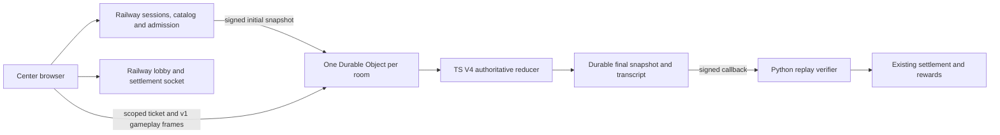

# Orbix multiplayer split: Cloudflare + Railway

Updated 2026-10-21: this supersedes the October 20 transport-scaffold status.
The user authorized the split runtime; existing Python reducer semantics remain
normative. The implementation and verification are described below, and actual
resources/settings are in the [deployment guide](cloudflare-multiplayer-deployment.md).

## Authority and request paths

Railway owns room creation/configuration, wallet sessions, admission, entry/hold
checks, profiles, moderation, tournaments, entitlement allocation and reward claims.
Cloudflare owns a pinned room's active movement/combat/loot simulation. The Worker
cannot accept client scores, winners or allocations. Railway replays its transcript
with the original committed snapshot and compares every final snapshot field, list,
RNG counter, score and eligibility state (absolute floating-point tolerance 1e-6).
Only then does the existing settlement code run. The allocation, nonce receipt and
result digest commit in one database transaction; a failed commit restores runtime
state and can be retried without duplicating entitlements. Finalized broadcasts
follow the commit. Same-content callbacks return the stored finalized frame even after a rematch
begins; conflicting content and cross-room receipt reuse are rejected.

Only V4 token-catch, combat-duel and boss-raid have TS adapters. Their reducer port
in `workers/multiplayer/src/v4.ts` preserves SHA256 stream RNG, terrain/colliders,
30Hz fixed steps, movement sequence acknowledgements and 250ms input leases,
jump/gravity/sprint, loot conservation, crates/airdrops, weapons/shields/dodge,
raid attacks/upgrades/crews and ranking eligibility. Initial state is generated by
Railway and provisioned immutably, avoiding duplicate initialization rules.

## Host selection and transport

Signed per-game admin configuration stores `host: railway|cloudflare`. A new room
snapshots the effective preference; toggles never migrate existing rooms. Legacy
rooms remain Railway. All templates except the three V4 games reject Cloudflare.
Token Catch alone defaults to Cloudflare when the complete API configuration is
present; otherwise it defaults to Railway. Combat Duel and Boss Raid remain Railway
by default pending live validation. Explicit admin preferences override defaults.
Tournament match room creation uses the same host resolver.

The browser retains its existing Railway WebSocket for admission, ready, presence,
rematch and settlement. On `transport.switch` or a Cloudflare-hosted running-round
sync, it requests an edge ticket through the authenticated API. Actions and sync
requests use the extra edge socket. Exponential reconnect requests a fresh ticket;
stale movement is not queued while disconnected. Closing the round tears down the
edge socket while retaining the control path for results/rematches.

The v1 protocol retains `session.hello`, `session.ready`, `action`, `action.ack`,
`action.rejected`, `game.patch`, `room.sync`, `room.snapshot` and ping/pong. Lobby
frames continue on Railway. Snapshots contain the same public world fields used by
the current renderer, including authoritative ticks and processed input sequences.

## Security and lifecycle

Three independent HMAC secrets cover edge tickets, provisioning/control and result
callbacks. Wallet Bearer sessions are verified only on Railway; tickets bind wallet,
room, round, role, audience, expiry and a single-use nonce. Tickets travel inside
the first WebSocket frame, never URLs. Admitted spectators receive read-only tickets; their actions are rejected, and
moderation closes suspended edge sockets. The DO enforces the frozen player roster,
allowed origins, message bounds, 60 frames/sec per socket and 64 connections/room.
Nonces persist in DO storage and expire through alarms. Public signed ingress
validates exact body/path, timestamp skew and nonce. The Worker result signature
uses `orbix/result/v1`; provisioning uses the separate `orbix/provision/v1` domain.
Railway never shares its vault/reward signer with Cloudflare.

The DO persists immutable bootstrap, replay journal and checkpoints. Critical
non-movement inputs checkpoint before the DO output gate releases their ack;
movement/ticks checkpoint at most every second. On reconstruction it restores the
same state and journal and resumes. Controls mirror Railway suspensions, privacy
settings and cancellation. Suspensions enter the replay journal; current Railway
moderation also applies to final eligibility. Public snapshots apply the same
hide-player/guess policies, with owner/self exceptions.

A finished checkpoint is the durable outbox. Alarms retry the callback with fresh
signatures; only a matching finalized response marks it settled. A cancelled round
stops simulation and callback delivery. A different round may reuse the room DO only
after the previous round is settled/cancelled; old sockets cannot act in it.

## Timing and verified boundary

The active loop targets 30Hz and broadcasts at 10Hz. The implementation preserves
Python's fixed-step clock, clears inputs after gaps over two seconds and bounds
catch-up to 60 steps; after a long gap it resumes from at most 250ms behind. The
active timer prevents hibernation. Per-second checkpoints and full journals have
storage/CPU costs; scaling requires measurement. The journal limit is 100,000
events and callback limit is 8MiB. Recovery can roll back less than roughly one
second of noncritical movement; it cannot create a second entitlement receipt.

All three reducers pass Python parity/restore tests. The live two-player Token
Catch canary measured 30Hz simulation and 9.78Hz received patches across reconnect
(10Hz target), handled input acknowledgements
and real loot, and settled through the new Python verifier. The 390px run reports
zero console and page errors. Exact observations are in
[live-round.json](../../tools/tests/evidence/cloudflare/live-round.json).
Verification used the deployed Worker with the updated local API over a temporary
tunnel, **not a deployed Railway update**. Hermes must deploy the API/site/settings
and repeat a production round. Funded payouts, isolate-kill recovery, 50-player load
and cross-region RTT were not verified. A nearby edge does not imply a local copy
of each room: one room is one single-location DO. No regional speedup is claimed.
